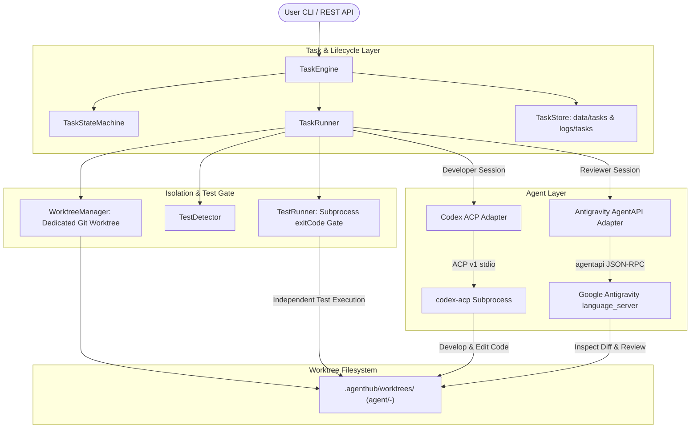
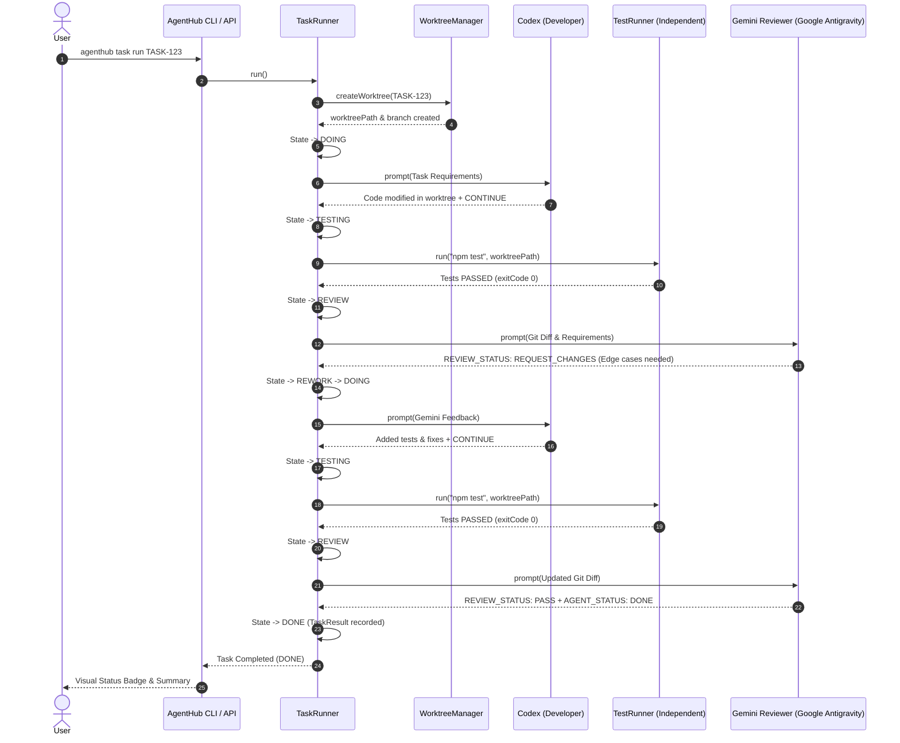

# AgentHub V0.2 Architecture Specification

## 1. Architectural Overview

`Codex × Gemini AgentHub` V0.2 在双 Agent 会话协作之外增加了围绕正式 Task 的任务引擎（Task Engine）：每个任务使用独立的 Git Worktree、独立测试门禁、审查与返工循环、本地 Fastify REST API 以及任务事件日志。V0.3 又增加了 Project Engine（项目 / 史诗 / 依赖 / 进度），见 [PROJECT_ENGINE.md](PROJECT_ENGINE.md)。本文描述的是本地个人工具的结构，不是经过生产验证的系统。

---

## 2. Core Modules

### 2.1 Task Engine (`src/tasks/`)
- **`TaskEngine` (`src/tasks/task-engine.ts`)**: 统一任务生命周期门面，负责任务创建、检索、运行、恢复、取消及项目关联。
- **`TaskRunner` (`src/tasks/task-runner.ts`)**: 任务运行执行器，协调 Worktree 创建、Codex 开发、独立测试门禁验证、Gemini 审查以及返工流转。
- **`TaskStateMachine` (`src/tasks/task-state-machine.ts`)**: 状态机校验器，管理 `TODO`, `BLOCKED`, `DOING`, `TESTING`, `REVIEW`, `REWORK`, `NEED_USER`, `DONE`, `FAILED`, `CANCELLED` 状态转移。
- **`TaskStore` (`src/tasks/task-store.ts`)**: 文件持久化存储，将任务状态落盘至 `data/tasks/<taskId>.json`，将不可篡改的事件审计流水落盘至 `logs/tasks/<taskId>.jsonl`，并支持父子任务树查询。
- **`TaskEvent` (`src/tasks/task-events.ts`)**: 结构化事件定义与生成器。

### 2.2 Git Worktree 隔离 (`src/git/`)
- **`GitService` (`src/git/git-service.ts`)**: 底层 Git 命令执行、仓库根目录探查、分支存在性校验、Diff 提取及修改文件收集。
- **`WorktreeManager` (`src/git/worktree-manager.ts`)**: 负责标题 Slugify、专用分支创建（`agent/<taskId>-<slug>`）、独立工作树挂载（`.agenthub/worktrees/<taskId>`）及防覆盖安全检查。

### 2.3 独立测试门禁 (`src/testing/`)
- **`TestDetector` (`src/testing/test-detector.ts`)**: 自动分析工作树环境，识别 `package.json` (`npm test`)、`pytest`、`cargo test`、`go test`、`mvn test`、`gradlew test` 或自定义测试指令。
- **`TestRunner` (`src/testing/test-runner.ts`)**: 独立拉起子进程执行测试命令，严格基于 `exitCode === 0` 判定结果，拒绝 Agent 自报。

### 2.4 Agent 层 (`src/agents/`)
- **`Agent` 统一接口 (`src/agents/agent.ts`)**: 抽象 `start()`, `initialize()`, `createSession()`, `prompt()`, `cancel()`, `close()`。
- **`CodexAgent` (`src/agents/codex-agent.ts`)**: 真实封装 `@agentclientprotocol/codex-acp@2.0.1`，驱动 `gpt-5.5` 作为 Developer。
- **`AntigravityAgent` (`src/agents/antigravity-agent.ts`)**: 真实集成官方 Google Antigravity Headless Agent API (`agentapi`)，驱动 `gemini-3.8-flash` 作为 Reviewer。

### 2.5 REST API & Server (`src/server/`)
- **`createServer` (`src/server/server.ts`)**: 基于 Fastify 的 HTTP REST 服务工厂。
- **`taskRoutes` (`src/server/routes/tasks.ts`)**: 暴露 Tasks 完整端点（创建、查询、运行、取消、恢复、事件、层级树）。
- **`projectRoutes` (`src/server/routes/projects.ts`)**: 暴露 Projects 完整端点。

### 2.6 CLI 入口 (`src/cli/`)
- **`taskCli` (`src/cli/task.ts`)**: 支持 `agenthub task create`, `run`, `status`, `events`, `cancel` 命令。
- **`server`**: 启动本地 Fastify HTTP 服务。

---

## 3. Communication & Execution Sequence

