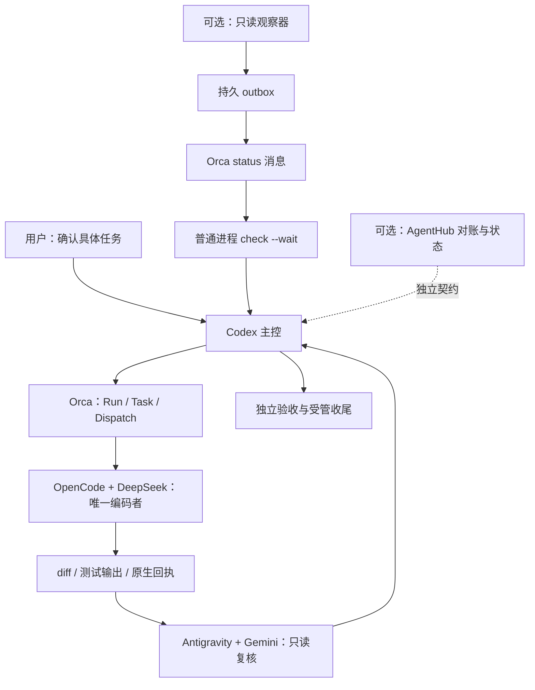

# Orca 多模型协作机制：可复用搭建方案

> 开源版说明：本文原为作者本地机制的分享说明。文中提到的“分享包模板”（规则、任务单、OpenCode 配置、验收清单模板）未包含在本仓库；仓库只包含 `scripts/`、`tests/` 中列出的代码。文中版本号为作者当时验证过的历史版本。


版本：1.0｜整理日期：2026-10-21｜适用对象：希望在本机以 Orca 协调多个编码与审查模型的个人及小团队。

本文是脱敏后的实施方案，不包含原现场账号、凭据、机器路径、Run、Task、Dispatch 或终端标识。示例中的路径、模型、资源标识必须在接收者环境重新核实。方案以 macOS 本机实测为基础；其他系统和其他版本需重新验收。

## 1. 这套机制解决什么问题

把“让几个模型聊天”变为“一个主控负责归属、一个开发者修改代码、另一个模型独立复核、可核查证据决定交付”的工程流程。

最小推荐组合：

| 角色 | 示例工具 | 主要责任 | 不应承担的责任 |
| --- | --- | --- | --- |
| 人工负责人 | 用户 | 确认任务目标、范围、费用及高影响例外 | 逐条替主控执行普通命令 |
| 主控 | Codex，经 Orca 原生会话 | 拆任务、核身份、派发、处理阻塞、最终验收、收尾 | 冒用其他会话身份、未授权扩大任务 |
| 开发 worker | OpenCode + DeepSeek | 在文件白名单内编码、自测、提交证据 | 自行扩大范围、批准自己、自动登记最终完成 |
| 独立 reviewer | Gemini，经 Antigravity | 检查真实 diff、测试断言和基线，给出复核意见 | 与开发者同时改同一文件、仅复述开发者结论 |
| 机制维护者 | 独立 Codex 工作区，可由同一人管理 | 配置、启动器、离线验证、操作手册 | 无业务授权时修改业务代码或替主控接管任务 |
| 普通过程 | Orca CLI、观察器、outbox | 等待、记录、受控通知 | 自动审批、替任务恢复、把终端文字当交付 |

角色可以换模型。主控与 reviewer 可由不同会话承担，但独立性应体现在职责、输入证据和判断过程，不能把同一份自报换个名字算独立审查。推荐先用一个开发 worker；只有文件范围真正不重叠时才并行。

**关键原则：同一业务范围只有一个执行所有者。** 一个任务不能同时由 Orca worker 和 AgentHub 内部 runner 执行。

## 2. 当前能力与实际边界

以下是来源环境截至本文整理日的证据总结，不是接收者机器的验收结论。

| 能力 | 证据状态 | 可以说明什么 | 不能说明什么 |
| --- | --- | --- | --- |
| 普通本机进程调用 Orca，只读 show/read | 已有真实验证 | 普通 shell 中可核身份、读取精确终端 | 受限模型沙箱也能连接 |
| 原生消息跨命令入队、阻塞接收、ack | 已有真实验证 | 发送、保留、接收、确认链条可运行 | 运行时重启后仍耐久、模型必然自动醒来 |
| 观察变化→持久 outbox→一条 status→阻塞收取→ack | 专用无模型终端真实验收通过一次 | 该测试对象上的接线成功 | 任意业务终端可直接开启观察 |
| OpenCode 指定免费 DeepSeek 的文本回复、合成文件 read | 已有真实验证 | 实际模型回复和原生工具读取成功 | 免费渠道持续可用、服务端账单已核实 |
| 原生“允许一次” | 用户现场确认；工具结果另有本地记录 | 此次人工批准及读取发生 | 已捕获完整原生审批事件审计链 |
| 主控换账号后的 Run 归属转移 | 已有真实普通绑定与前后查询 | 当次 coordinator 变化及消费代数递增 | 账号切换自动迁移所有会话和执行权限 |
| 完整业务自动观察 | 未放行 | 元数据映射和只读审计可辅助核验 | 非原子快照能证明 OS 进程归属 |
| OpenCode/DeepSeek 的旧 AgentHub 绑定适配 | 所检查旧实现不支持 | 需要显式扩展或选择独立原生流程 | 把 DeepSeek 登记成 Codex 就能兼容 |
| 当前免费端点稳定性 | 最近一次业务尝试报 HTTP 429 | 上游拒绝会阻断编码，客户端可能内置重试 | 仅凭 429 判断账号额度、全局容量或根本原因 |

不要把不同日期、不同源码版本或不同任务的测试数量相加，形成一个看似完整的“总通过数”。

## 3. 推荐架构：基础闭环与两个可选增强层



### 3.1 基础闭环：新搭建者先选这一层

Orca 负责执行归属；主控完成任务说明、派发和接收结果；开发 worker 修改文件；独立 reviewer 给意见；主控验收并正常保留、复用或释放 worker。

基础闭环不依赖 AgentHub，也不需要一开始实现 watcher。工作证据保存在明确目录即可。不要先引入第二套任务库再花时间协调两个执行器。

### 3.2 增强层一：普通进程观察和通知

只适合已经证明对象映射、发送身份和消息目标正确的场景。它用普通进程承担等待，模型只在需要判断时运行。

通知只能表示“观察到未经核验的变化”，不能表示“批准”“恢复”“完成”。主控收到消息后仍核对对应 Task/Dispatch 和实际交付。

### 3.3 增强层二：AgentHub 对账和结构化验收

只有明确需要结构化任务存储、版本快照、交付导入和正式状态写回时再接入。

必须先审查实际源码支持哪些 developer、reviewer、provider、绑定状态及转换操作。来源实现的旧 `OrcaBinding` 仅支持 Codex/Gemini 和 Codex/Antigravity 组合，并拒绝覆盖已有 binding/baseline；因此它不能直接承接 OpenCode 开发者。

可选做法：

1. 正式扩展身份、快照、转换、验收及测试契约，审查后部署。
2. 对**尚无该门禁的新项目**明确采用 Orca 原生闭环，暂不接 AgentHub。
3. 对**已经受旧门禁约束的任务**，先处置原执行，再由用户明确批准限于该任务的合同例外，记录历史对账缺口；不能自行绕过。

Orca-bound 任务不得进入 AgentHub 内部 `pendingAgentTurn` 恢复链。不得删除拒绝检查、伪造 checkpoint、创建同范围 runner 或伪造“正常验收完成”。

## 4. 准备环境与目录

### 4.1 环境清单

- Orca 已安装，找到其公开 CLI 的真实绝对路径。
- Codex、OpenCode、Antigravity 在**实际执行宿主**上可运行。
- 每个账号有合法权限，实际模型和费用渠道已核验。
- 业务代码目录与机制目录分开；保留现有 Git 分支、未提交和未跟踪改动。
- 单独的日志、缓存、凭据存储策略；分享材料不包含原始会话数据库。
- Python/Node 等只按本机已安装版本使用；安装和下载由接收者另行决定。

来源环境检查过 Orca 1.4.230、OpenCode 1.19.3 等版本；这些是历史验证版本，不是安装“最新版”的命令或兼容性保证。

### 4.2 建议目录

```text
mechanism/
  docs/                         # 规则、说明、验收记录
  config/                       # 无秘密的环境配置
  scripts/                      # 机制脚本，不是业务代码
  outputs/<operation-id>/       # 每次操作的新目录，不覆盖
business/
  AGENTS.md
  docs/TASK_AUTHORIZATION_POLICY.md
  docs/CURRENT_TASK.md
  src/
  test/
```

本分享包附规则、任务单、OpenCode 配置、验收清单和状态记录模板。**没有附带一键安装器、现成身份、凭据或运行时认证材料。**

不要原样搬用来源项目的启动脚本：其中可能固定了机器路径、文件哈希、项目、终端和单次发送预算。接收者必须自行适配与验证。

## 5. 第一次搭建：按七步完成

### 第一步：确认公开 CLI 和当前身份

以下代码块中的 `"/absolute/path/to/orca"` 是占位路径，必须替换为本机实际路径；不得直接复制执行。各子命令以安装版本的 help/skill 为准。

```bash
"/absolute/path/to/orca" skills get orchestration
"/absolute/path/to/orca" status --json
"/absolute/path/to/orca" orchestration run-current --json
```

在准备充当 worker 的普通 Orca shell 中，显式核查其自身句柄：

```bash
if [ -n "${ORCA_TERMINAL_HANDLE:-}" ]; then
  "/absolute/path/to/orca" terminal show \
    --terminal "$ORCA_TERMINAL_HANDLE" --json
else
  printf '%s\n' 'STOP: no native terminal identity'
fi
```

核对工作区、handle、connected、运行时和已有绑定。环境变量只是定位线索，不是权限证明；不要 export 别人的 ORCA_*，不要使用 `--from` 冒充。不要省略对象后选“最新终端”。

同一个模型窗口有 Orca 工具，不等于其 Node/Python 子进程能连接。若受限环境出现 EPERM/runtime_access_denied，应区分本地 IPC 拒绝与运行时自身拒绝；不要以重装、提权、改权限、换可执行文件或重启掩盖问题。由合法普通 shell 承担现场操作，机制侧继续做离线工作。

### 第二步：先验证模型，不要从业务任务开始排错

在独立空目录做两项有界试验：

1. 固定 provider/model，回复一个确定短字符串，无工具。
2. 放入一个合成文件，让模型通过原生 read 读取；人工允许一次，检查工具结果和最终回答。

每次试验记录真实模型路由、版本、返回文本、错误、工具事件、结束原因、退出码及费用证据。合成内容不含真实用户数据、真实账号或业务秘密。

免费模型目录价格为 0、客户端估算为 0、服务端账单为 0 是三件不同的事。本机制只记录各自证据，禁止付费 fallback。来源使用过 `opencode/deepseek-v4.1-flash-free`；接收者应核对当前渠道资格与可用性，不能把本文当作持续免费承诺。

曾遇到的实际问题：

- 所有工具 deny 时收到免费层 403；改原生 read 为 ask 后同路由成功。这是一次对照支持的兼容线索，不是所有 403 的唯一修复。
- 128 token 上限让模型在 reasoning 阶段 `finish=length`，还没有调用工具；不能误诊为审批死锁。适当配置任务预算，不无限加大。
- 后来免费请求收到 429，且客户端内置重试；需要中止并保存未知状态，不重复发送同一任务。

### 第三步：写入项目规则和任务单

复制并审阅分享包 `templates/AGENTS.md`、`TASK.md`。已有文件应做合并，先备份并保存差异，绝不直接覆盖。

一项任务必须具备：目标、准确文件白名单、只读依赖、验收命令/标准、唯一开发者、独立 reviewer、模型渠道、禁止事项、失败策略和证据位置。

“继续推进项目”不等于可以安装依赖、碰真实数据、改全局权限或部署。目标明确且范围已批准后，主控应自主处理普通步骤，不把每条命令都交回用户。

### 第四步：选择原生派发路径

**路径 A：Orca 能识别 CLI，使用原生新 worker。**

以下均会创建资源/触发工作，只在任务已获授权、没有重复执行者时执行：

```bash
"/absolute/path/to/orca" orchestration run-create \
  --objective "<APPROVED_OBJECTIVE>" --json

"/absolute/path/to/orca" orchestration worker-start \
  --spec "<SELF_CONTAINED_APPROVED_TASK_SPEC>" \
  --worktree current --agent opencode \
  --model "<VERIFIED_PROVIDER_MODEL>" --json
```

来源版本支持 OpenCode 在已有工作区选择 model，不支持 OpenCode effort；新工作区和远端能力另有约束，必须重新读 help。Codex 主控不会因为示例而自动变为 worker。

**路径 B：已有受控 OpenCode 终端，需要显式接管。**

先在业务项目中新建普通 shell，用经过适配的启动器打开空闲 OpenCode；精确核对其身份和无冲突状态。再由主控使用：

```bash
"/absolute/path/to/orca" orchestration worker-start \
  --spec "<SELF_CONTAINED_APPROVED_TASK_SPEC>" \
  --worktree "path:<EXACT_BUSINESS_WORKSPACE>" \
  --terminal "<VERIFIED_IDLE_WORKER_TERMINAL>" --json
```

`--terminal` 不与 `--model/--effort` 混用；模型在终端启动时已固定。不要使用 `dispatch --inject` 假装已经取得进程管理权；来源契约将其视为 unsupervised 路径。

CLI 路径可以通过受支持宿主设置配置，但宿主级命令覆盖可能影响其他项目；不要为了单项目试用默默修改全局 PATH。来源实践通过绝对二进制路径启动独立终端，避免依赖 GUI PATH 与终端 PATH 相同。

### 第五步：正式门禁与模型分工

worker 根据本次真实注入的生命周期说明执行，不从文档重构别人的 ask、heartbeat 或 worker_done 命令。如果项目要求“绑定并放行前不读项目”，就先仅等待；不能边等待边开发。

开发交付至少包括真实 diff、修改文件列表、测试命令与输出、已知限制。Gemini reviewer 读取这些材料和源码，检查断言是否证明目标、是否有越界、是否误用旧输出；不得只回复“开发者说通过”。

只有开发者停在明确交付点之后 reviewer 才介入；修复意见回给同一个开发者，保留同一任务归属。审查阶段默认只读。Codex 最终核实结果和归属，才决定下一步。

### 第六步：按原生消息等待，不让模型空转

主控在自己的合法 shell 通过一个阻塞命令等待：

```bash
"/absolute/path/to/orca" orchestration check \
  --wait --types "worker_done,escalation,question" \
  --timeout-ms 900000 --json
```

该参数组合是来源版本的示例；实际超时可按任务确定。长等待由普通进程承担，不由模型重复发起终端读取。keepalive 是连接保活，不是 worker 心跳，也不是业务进展。

消费 check 可能返回整个 FIFO 批次；`--types` 不代表可以忽略同批其他消息。核对所有消息和实际归属后才 ack。不得为了“清空邮箱”确认非预期消息。只读查看可按 help 使用 `--peek` 或 `--all`，不要无意执行默认消费 check。

入队成功只证明发送成功；阻塞接收、核验和 ack 是另外的步骤。没有可靠模型自动唤醒保证时，人工在必要时转交一条摘要和证据路径即可，不用模型轮询。

### 第七步：独立验收与收尾

区分至少六层：配置准备、离线检查、真实渠道、任务执行、独立复核、正式状态写回。某层通过不自动升级下一层。

主控检查：基线未被越界修改，实际测试命令正确、退出码与断言有效，review意见已处理，原生完成回执匹配本次 Task/Dispatch。不能从终端“DONE”、模型自报、测试通过或普通进程退出码单独判完成。

明确 settled 后才按原生契约复用、保留或释放 worker。未确定退出、超时或失联时不自动 stop/release。若要取消未知进程，是一个主动取消决定，应明确授权、精确对象和安全退出证据，不能用“没输出”代替。

## 6. 身份、代数和映射：必须拆开记录

| 要素 | 来源与用途 | 常见错误 |
| --- | --- | --- |
| runtimeId / host | 当前运行时回执 | 重启后继续使用旧现场假设 |
| workspace / worktree | 终端与派发回执 | 只比较目录名称或包含字符串 |
| terminal handle / pane / PTY | 当前终端身份与位置 | 按标题或“最新”终端绑定 |
| Run coordinator_handle | Run 的协调归属 | Google登录账号等同于coordinator |
| Run consumer_generation | Run 消费与协调代数 | 转移后强制改所有旧Dispatch记录 |
| Task / Dispatch ID | 业务任务与具体一次执行 | 同一Task重新开进程却沿用旧执行权 |
| Dispatch consumer_generation | 原生Dispatch记录中的历史字段 | 当作通用、跨系统的执行generation |
| process_incarnation | 原生记录的进程实例关联 | 仅拼接PTY属性就宣称OS所有权已证明 |
| AgentHub orcaGeneration | AgentHub自己的绑定代数 | 与Run消费代数或进程实例混为一谈 |
| provider session | 模型会话 | 扫描“最新聊天”恢复任意任务 |

不存在一个通用 `generation` 可以替代所有字段。保存原生字段名、层级和来源，不能猜 camelCase/snake_case 兼容。来源版本的 `dispatch-show --task` 返回 `result.dispatch`，其关键字段为 `id/task_id/run_id/assignee_handle`；`terminal show` 返回 `result.terminal`。接收者需确认自己的安装版本。

两步只读查询是非原子快照；可以核对映射，但不能据此宣称已证明实时 OS 进程归属。业务观察要求的证明不足时应保持阻断。

## 7. 一次任务授权与工具权限是两套门禁

### 7.1 项目授权规则

用户一次批准具体任务的目标、白名单、验收和渠道后，主控可自主完成范围内的只读核查、必要新资源、合法放行、编码测试、任务消息、独立验收和正常收尾。不要再逐命令请求聊天批准。

仍需单独授权：扩大目标/白名单/验收标准，安装依赖，接触真实个人数据、数据库或秘密，删除业务文件，部署/提交/推送，持久凭据、全局配置或权限变更，历史绑定/锁变更，以及结果不明后的重新执行。

### 7.2 工具策略

OpenCode 的 permission 分别支持 allow、ask、deny；规则应针对实际生效配置检查。初次搭建建议保留 read/edit/shell 的人工确认，然后再为确定的普通读取和测试路径做窄规则。[官方权限说明](https://opencode.ai/docs/permissions/)

项目规则中的“无需逐条聊天确认”不会消除工具弹窗；模型不能自动点击人工批准。任意 shell 即使是 ask，也不是文件系统沙箱，获准命令可能拥有宿主权限。

不要为了省几次点击开启全局跳过权限。reviewer 的只读职责也应由文件权限/工具规则配合保障，不只写在提示词里。若需要运行具有缓存/临时文件写入的测试，应在独立验收目录执行并先明确其写入范围。

## 8. OpenCode 隔离与鉴权

本包的 `opencode.example.json` 固定单一示例免费模型、仅opencode provider、工具人工审批、关闭插件/MCP/自动更新等。它是配置示例，不是OS沙箱，也不保证彻底隔离所有父目录/全局配置。

OpenCode存在多级配置与合并，项目文件不一定就是最终配置；应用前备份原件，检查最终生效结果，不输出包含密钥的 resolved config。[官方配置说明](https://opencode.ai/docs/config/)

经适配的启动器应做到：

- 固定官方CLI绝对路径、版本与摘要；不执行未知同名程序。
- 先核当前终端和workspace，再询问key；只接受交互式隐藏输入，不退回明文/管道。
- key仅注入本次子进程的受支持配置，不写argv、项目文件、授权回执或聊天。
- 独立XDG配置/缓存/状态/数据和临时目录；只继承本次合法运行时必要环境，不复制其他项目ORCA_*。
- 验证最终权限、工具、provider和small_model；不让辅助调用偷偷走付费模型。
- 关闭自动下载，且通过该版本实际支持的机制阻断依赖 housekeeping；`--pure`不能单独证明零下载。
- 没有正式任务时不传prompt，不因打开TUI就宣称发过模型请求。
- 发生Ctrl-C/超时时只处理本次自己创建的进程；不要误杀既有业务进程。

临时进程环境不等于秘密绝对不可见：同权限进程、子进程或日志仍可能接触它。运行中不分享原始log或SQLite；退出后扫描/脱敏，不能安全处理的秘密残留必须报告，不能宣称“无泄漏”。未保存key意味着后续新进程可能需要重新人工输入。

## 9. 可选通知层的正确实现合同

推荐先把原生 worker 消息闭环跑通，再实现观察器。下列是实现要求，不是本分享包已附可直接部署的观察器。

### 9.1 接线

```text
精确对象快照 → baseline → 普通进程只读等待
→ 检测变化 → 私有持久outbox → 一次发送尝试
→ 原主控check --wait → 归属核验 → 人工决定/正常处理 → ack
```

观察对象和通知目标分别固定。sender使用运行进程本来的合法身份，不复制另一个发送终端的环境，不传伪造from。每轮发送前后检查runtime/workspace/terminal/Run owner/consumer_generation；漂移就停。

来源环境实际读取文本字段为 `result.terminal.tail`，但接收者应自行inspect确认。不能把主控反复读stdout当主动通知。

### 9.2 outbox与结果不明

实现可采用以下语义状态；名称不是Orca原生枚举：

| 状态 | 含义 | 可以做什么 |
| --- | --- | --- |
| OBSERVED | 事件已本地记录，尚未发送 | 按授权进入发送 |
| ATTEMPT_RESERVED | 发送意图已持久化，可能进入网络 | 禁止并发第二次发送 |
| ENQUEUED | 取得明确消息入队回执 | 等待接收，不重复发送 |
| UNKNOWN | 超时、取消、崩溃或回执丢失 | 用原requestId只读查询；没有ID则保留未知 |
| ACK_VERIFIED | 接收端已核验并确认 | 记录闭环，不宣称业务完成 |

唯一事件键至少关联精确观察对象、基线/变化摘要和目标Run消费代数；配置摘要和授权预算共同防止误投。内容相同不是跨任务通用事件ID。

必须先持久化发送意图再调用传输；进程重启使用同一store，不删除锁、不换目录绕预算。该模式能防盲目重复，不能凭本地SQLite宣称端到端exactly-once。

拿到requestId后查询原请求；pending/absent不是“没发送”的证明。普通命令重跑、新UUID重发以及换store都不是安全恢复。服务端幂等恢复也必须依据确切契约和授权决定。

### 9.3 该层验收

无变化不反复唤起模型；变化只产生待核验通知；审批提示不触发按键；重复、超时、取消、重启均不重复派发；身份/代数漂移停止；不明结果不清锁、不重绑、不恢复业务。真实验收先用专用无模型终端，一条消息，从发送、入队、阻塞收取到ack逐段留证。

自动wake/nudge只能是尽力而为的注意提示。本文不承诺空闲/关闭的模型主控自动开始新回合。

## 10. 故障与恢复决策

| 情况 | 先记录什么 | 允许的下一步 | 禁止的推断/动作 |
| --- | --- | --- | --- |
| 本机EPERM/runtime_access_denied | 哪个进程、哪层连接失败 | 在合法普通环境核查 | 重装、提权或断言Orca宕机 |
| provider 401/403 | 状态码、错误类别、实际路由 | 只核身份/资格/配置 | 直接充值、泄露key、盲换渠道 |
| provider 429/Endpoint unavailable | 原请求、客户端重试情况 | 中止重试并保留；另定单次恢复 | 断言唯一根因、自动反复“继续” |
| finish=length且无tool | 输出预算、reasoning/tool/stop事件 | 调整任务预算后另定对照 | 误称工具审批已通过或死锁 |
| TUI在线但没输出 | 原生liveness来源、完整性 | 只读核查或正常等待 | idle/PTY connected等于进程退出 |
| 主控换号/新窗口/runtime变化 | 新旧身份、Run owner/代数 | 保存交接并只读比对 | 立即run-use或自动takeover |
| 旧Dispatch仍active，分工改变 | 精确旧目标、执行/问题状态 | 明确取消/转换方案后再授权 | 新开同范围worker绕过旧执行 |
| Task有binding/baseline不可覆盖 | 版本、实现拒绝原因 | 设计受控转换并保留历史 | 清字段、回退revision、伪造身份 |
| 只有测试/审查通过，状态仍DOING | 导入与验收门禁缺口 | 如实对账、独立结案类型 | 为修看板重复开发或强写DONE |

OpenCode可能在一个用户回合内部重试；“主控没有重发任务”不等于provider只收到一次请求。启动器超时也不等于后代进程已全部清理。实施时必须分别验证。

## 11. 换账号、换主控与跨项目隔离

账号表示模型鉴权；terminal/Run表示编排身份，两者互不替代。新Google账号可回复，只证明该次模型通道可用，不证明新终端已是旧Run主控。

建议流程：暂停新派发→保留交接→完成合法登录/选择→新会话只读核身份/Run→用户明确授权必要归属变更→单次run-use→run-current/run-show交叉核验→再决定恢复业务。不要默认添加takeover标志，具体条件以安装版本legacy契约为准。

Antigravity提供原生账号和会话相关操作，操作前核实具体CLI版本及界面；已有进程是否采用新账号需另查。[官方CLI说明](https://antigravity.google/docs/cli/features/)

绑定成功后保留原Task/Dispatch历史代数，不手动让全部字段“看起来一致”。主控转移、旧worker处置、新任务授权是不同动作，不能用第一次授权覆盖后三者。

每个项目使用自己的规则、基线、终端、Run和凭据注入。跨项目只复用机制代码和去身份化模板，不复用实时绑定、旧授权、锁、worker会话或测试消息预算。

## 12. 证据与交付标准

每次重要操作建立新的私有目录：

```text
operation/
  task.md
  authorization.json       # 记录人工授权来源，不冒充签名认证
  identity.json            # 实际回执填写，不预填旧值
  baseline.json
  raw/                     # 私有，不直接对外分享
  stdout.txt
  stderr.txt
  exit.json
  result.json
  review.md
  manifest.json
```

实际工具可能只返回包含output的封装对象：如实保存，不能冒称已分离stdout/stderr。用户口头/截图确认、原始机器事件、离线合成结果分别标来源。hash证明字节相关性，不证明作者、授权或来源真实。

配置修改保存原件、after、diff和应用回执；文件已变化则拒绝覆盖。manifest只包含本次明确材料，不扫描打包HOME、密钥或整套会话数据库。

对外完成报告应包含：具体变化、实际测试、独立复核、原生执行状态、保留/释放状态、未验证项和后续动作。用“编码完成/测试通过/复核通过/正式结案”分别描述，不用一个PASS抹平缺口。

## 13. 分阶段验收表

| 阶段 | 必须取得的证据 | 未通过时停在哪里 |
| --- | --- | --- |
| P0 环境 | 实际CLI、版本、宿主、原生身份、workspace | 不派发 |
| P1 模型 | 固定路由真实短回复、一次合成read、费用口径 | 不进入业务 |
| P2 任务 | 授权、白名单、基线、唯一执行者、真实新回执 | 不放行开发 |
| P3 执行 | diff、实际测试输出、匹配交付 | 不进最终验收 |
| P4 复核 | 独立review、缺陷闭环、Codex核验 | 不宣布业务完成 |
| P5 收尾 | 原生settlement、保留/复用/释放决定、状态对账 | 不伪报资源清理或DONE |
| N 可选通知 | 一条真实变化通知的完整五段证据 | 继续原生消息/人工沟通 |
| H 可选AgentHub | 正式身份/转换/导入/验收契约 | 不写其正式完成状态 |

新团队最小试运行建议：一个新项目、一项小型合成任务、一个开发者、一个只读reviewer。先闭合P0至P5，再扩展并行、通知和外部任务存储，不拿生产数据做通道调试。

## 14. 分享包内容与使用方式

1. 阅读本方案，选择“基础闭环”是否足够。
2. 将模板填入自己的路径、范围和费用策略；审阅后合并进项目，不覆盖已有文件。
3. 对照检查清单逐阶段验证，把未通过项记为NOT_VERIFIED或BLOCKED。
4. 使用自己的新鲜原生身份和证据，不导入任何来源项目运行数据。
5. 账号登录、软件下载、模型请求、资源创建和业务操作由接收者按自身授权实施；解压此包不触发这些动作。

本包没有自动执行脚本，不要求先复制作者的AgentHub、数据库或本机绝对路径。任何“只要开全局权限就能解决全部协作”的做法，都不属于本方案。
